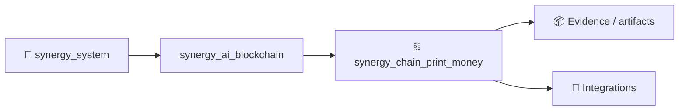

# ⛓️ SYNERGY Chain Print Money

> **Домен:** Blockchain / Monetary R&D  
> **Роль:** Концептуальный узел интеграции chain-механики с исследованиями programmable liquidity, mint/burn и внешне подтверждаемого экономического результата.  
> **Статус:** 🧱 STUB / R&D — эмиссия сама по себе не трактуется как прибыль или создание внешней стоимости.  
> **Архитектурный родитель:** [`synergy_ai_blockchain`](https://github.com/Shtenco/synergy_ai_blockchain)

---

## 🎯 Задача репозитория

Концептуальный узел интеграции chain-механики с исследованиями programmable liquidity, mint/burn и внешне подтверждаемого экономического результата.

Этот README оформлен по общему стандарту документации SYNERGY: цель → архитектура → границы полномочий → статус доказанности → место в федерации → roadmap.

---

## 🧠 Место в системе



Архитектурная стрелка означает принадлежность к системному домену. Она **не доказывает** наличие runtime dependency, импорта или готовой интеграции.

---

## 🏗️ Архитектурный контракт

Для перехода из концепта/R&D в подтверждённый компонент репозиторий должен явно описать:

- входные данные и их источник;
- выходные артефакты и формат;
- доверительные границы;
- deterministic validation там, где она возможна;
- конфигурацию и секреты без хранения ключей в README/коде;
- тесты и воспроизводимый запуск;
- ошибки, отказоустойчивость и rollback;
- метрики, по которым можно отличить успех от красивой демонстрации;
- взаимодействие с соседними authority-доменами без дублирования их полномочий.

---

## 🛡️ Authority boundaries

В федерации SYNERGY действуют жёсткие разграничения:

```text
AI recommendation       != authorization
service running         != permission
blockchain record       != accounting truth
mint / rebase           != external profit
UI state                != ledger state
architecture diagram    != tested integration
repository name         != proof of implementation
```

Этот репозиторий должен оставаться в пределах своей предметной области и передавать результаты каноническим владельцам соседних фактов.

---

## 🔬 Статус доказанности

🧱 STUB / R&D — эмиссия сама по себе не трактуется как прибыль или создание внешней стоимости.

Применяемая шкала:

| Метка | Значение |
|---|---|
| ✅ GREEN | воспроизводимо подтверждено тестами/артефактами |
| 🟡 CANDIDATE | реализация есть, но доказательство неполное |
| 🔬 R&D | экспериментальная линия |
| 🧱 STUB | архитектурный узел без достаточной реализации |
| 🕰️ LEGACY | историческая ветка / provenance |
| ❌ RED | тезис не прошёл проверку |

---

## 🔗 Связанные репозитории

- [`print_money_synergychain`](https://github.com/Shtenco/print_money_synergychain)
- [`synergy_graph_print_money`](https://github.com/Shtenco/synergy_graph_print_money)
- [`synergy_qe`](https://github.com/Shtenco/synergy_qe)
- [`synergy_financial_os`](https://github.com/Shtenco/synergy_financial_os)

Главная карта:
- [🧭 SYNERGY SYSTEM](https://github.com/Shtenco/synergy_system)
- [📚 Атлас всех 75 репозиториев](https://github.com/Shtenco/synergy_system/blob/main/docs/SYNERGY_REPOSITORY_ATLAS.md)
- [🧾 Машиночитаемый registry](https://github.com/Shtenco/synergy_system/blob/main/registry/SYNERGY_REPOSITORIES.json)

---

## 🧪 Критерий перехода в GREEN

Репозиторий нельзя считать зрелым только потому, что появился код. Для GREEN нужны как минимум:

1. воспроизводимый запуск с чистого окружения;
2. version-pinned зависимости;
3. тесты основной функции и негативных сценариев;
4. сохранённые evidence artifacts / metrics;
5. отсутствие скрытого ручного шага в заявленном pipeline;
6. documented failure modes;
7. проверенная интеграционная граница с родительским слоем;
8. README, который не утверждает больше, чем подтверждают артефакты.

---

## 🗺️ Документационный стандарт

По мере развития README должен расширяться предметными разделами, а не общими лозунгами:

```text
проблема
  ↓
теория / модель
  ↓
реализация
  ↓
эксперимент
  ↓
метрики
  ↓
ограничения
  ↓
воспроизводимость
  ↓
следующий рубеж
```

Эталон глубины оформления: [`Shtenco/dlp_solver`](https://github.com/Shtenco/dlp_solver).

---

## 🚀 Roadmap документации и реализации

- [ ] описать реальный file tree после появления/ревизии исходников;
- [ ] добавить Mermaid-диаграмму уже фактических модулей;
- [ ] закрепить inputs/outputs в машиночитаемой схеме;
- [ ] добавить smoke/integration/negative tests;
- [ ] сохранить benchmark/evidence artifacts;
- [ ] задокументировать связи с соседними репозиториями;
- [ ] добавить CI-проверку README и битых cross-repo links;
- [ ] повысить статус только после воспроизводимой проверки.

---

## 🛑 Что этот репозиторий пока НЕ утверждает

- что концептуальная архитектура уже является production-системой;
- что наличие README доказывает работоспособность;
- что cross-repo связь означает готовую интеграцию;
- что непроверенные performance/security/economic claims являются фактами;
- что этот репозиторий может присваивать authority соседнего домена.

---

## Коротко

```text
одна ответственность
      ↓
явные границы
      ↓
проверяемые артефакты
      ↓
связь с 75-repo federation
      ↓
только затем GREEN
```
